  

  
  
   

  

 

## `~/` sobre

Sou **Alison Alves de Aquino**, analista de sistemas — na prática, o time de TI inteiro de uma
empresa de instrumentos musicais. Isso significa que o mesmo dia pode começar com um retorno
bancário CNAB travado e terminar desenhando a camada Gold de um lakehouse.

O que eu realmente faço: **tiro o Excel do meio do caminho**. Relatório que alguém montava à mão
toda segunda vira query no HANA, pipeline em Python e dashboard que se atualiza sozinho.

- Sustento o **SAP Business One (HANA)** e seus add-ons fiscais, de produção e de cobrança
- Construo integrações e ETL: `SAP B1 → Supabase → Metabase/Power BI`, carga diária
- Migro relatórios financeiros de planilha com ODBC para modelos nativos em **Power BI**
- Automatizo o que for repetitivo — **Python**, **Power Automate**, APIs, fluxos low-code
- Comecei com **Automação Industrial** na ETEC; hoje curso **Ciência da Computação** (3º semestre)

> Fora do terminal, eu toco guitarra. Trabalhar com instrumentos musicais não foi acidente.

 

## `~/` stack

**SAP & ERP**

**Dados & BI**

**Automação & Dev**

 

## `~/` projetos

<table>
<tr>
<td width="50%" valign="top">

### Plataforma de Dados Corporativa
Lakehouse em arquitetura medalhão (Bronze/Silver/Gold) para centralizar
vendas, pedidos, estoque e faturamento. Mais de **556 mil linhas** de vendas
carregadas em PostgreSQL sobre Docker.

`Python` `PostgreSQL` `Docker` `SAP HANA`

</td>
<td width="50%" valign="top">

### Painel Comercial — Metabase
Migração de dashboards de Qlik para **Metabase self-hosted**, lendo do
Supabase alimentado diariamente a partir do SAP B1. Distribuído aos
representantes comerciais.

`Metabase` `Supabase` `SQL` `Docker`

</td>
</tr>
<tr>
<td width="50%" valign="top">

### Migração do P&L para Power BI
Saída de uma planilha com 24 abas e 5 conexões ODBC para um modelo
estrela nativo: fato de resultado, dimensões e medidas DAX de DRE,
validadas contra a base legada.

`Power BI` `DAX` `Power Query` `ODBC`

</td>
<td width="50%" valign="top">

### Extração SAP → Excel automatizada
Automação em Python que puxa pedidos direto do HANA via ODBC e escreve
em Tabelas nomeadas do Excel, com refresh controlado por polling em
arquivos sincronizados.

`Python` `pyodbc` `openpyxl` `win32com`

</td>
</tr>
<tr>
<td width="50%" valign="top">

### Bot de Discord
Bot em `discord.py` com comandos slash efêmeros, boas-vindas automáticas
e comandos de staff que publicam e fixam mensagens sem duplicar a fixada
anterior.

`Python` `discord.py` `dotenv`

</td>
<td width="50%" valign="top">

### Relatórios Crystal no SAP B1
Customizações em relatórios de produção: lista de picking com dados de
transportadora e UF, e relatório de comissão de vendedores e
representantes com baixas de NF.

`Crystal Reports` `SQL` `SAP B1`

</td>
</tr>
</table>

 

## `~/` github

  
  

  

  

 

## `~/` contato

  
  

  

